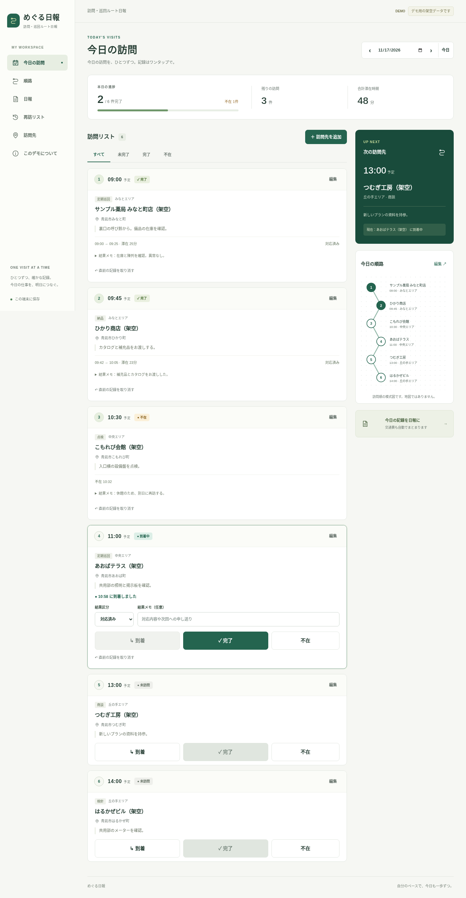

# 訪問・巡回ルート日報

## 概要

「めぐる日報」は、ルート営業・設備巡回点検・メーター検針などを担当する
1人のための、訪問リスト・ワンタップ記録・日報アプリです。
スマートフォンでの操作を中心に、デスクトップでも使える日本語UIを備えています。

## 主な機能

### 1. 本日の訪問リストと順路

- 日付ごとの訪問先、エリア、住所の目安、用件、予定時刻、メモを管理。
- 訪問先の追加・編集・削除、よく行く訪問先マスタからの追加。
- 上へ・下へボタンで並べ替え、番号付きSVG模式図で順路を確認。
- 区間ごとに徒歩・自転車・車・電車／バス、距離または運賃を入力。
- 模式図は地図ではありません。地図APIやGPSは使用していません。

### 2. 到着・完了・不在のワンタップ記録

- 高さ56px以上のボタンで到着・完了・不在を記録。時刻は日本時間で表示。
- 到着から完了までの滞在時間を計算し、直前の記録を取り消せます。
- 完了時に対応済み・要再訪・持ち帰りを選択し、任意の結果メモを記入。
- 不在・要再訪を自動抽出し、別日の訪問リストへ追加。
- 進捗と次の訪問先を表示。時刻記録は今日の訪問に対して利用できます。

### 3. 日報と交通費のまとめ

- 件数・完了・不在・要再訪、稼働時間、合計滞在時間と訪問結果を集計。
- 車は距離×単価（既定15円/km、区間ごとに四捨五入）、電車・バスは入力運賃、
  徒歩・自転車は0円として交通費を計算。
- 日報テキストのコピー、BOM付きCSVのダウンロード、所感の自動保存。
- 月曜日から日曜日までの件数と交通費を一覧表示。

## 既存作品との違い

| 既存作品 | 本作との違い |
| --- | --- |
| 配送・配車管理システム | 本作は1人の訪問記録が中心。車両・ドライバー割当、配車ボード、POD、管理者の運行管理は扱いません。 |
| 経費精算・承認システム | 本作は訪問区間の交通費集計のみ。経費申請、多段承認、精算ワークフローは扱いません。 |
| Physical AI Suite | 本作は人の現場業務向け。ロボットの日報・配車は扱いません。 |

## 画面一覧

| パス | 画面 | 内容 |
| --- | --- | --- |
| `/` | 今日の訪問 | 進捗、次の訪問先、訪問リスト、ワンタップ記録 |
| `/route` | 順路 | 並べ替え、移動区間の編集、SVG模式図 |
| `/report` | 日報 | 日付切り替え、結果一覧、交通費、コピー・CSV、所感、週の一覧 |
| `/revisit` | 再訪リスト | 不在・要再訪の抽出、別日への追加、追加済み記録の確認 |
| `/places` | よく行く訪問先 | マスタの検索・登録・編集・削除、指定日への追加 |
| `/about` | このデモについて | データ説明、交通費単価設定、既定データへのリセット |

## 技術スタック

- Next.js 16 / App Router
- React 19 / TypeScript
- Tailwind CSS 4 / カスタムCSS / SVG
- ブラウザのlocalStorage・Clipboard API・Blob API
- ESLint / TypeScript型チェック / Node.js標準テストランナー

主要な純粋関数は `src/lib/logic.ts`、型は `src/lib/types.ts`、
シードは `src/lib/seed.ts`、保存データの検証は `src/lib/storage.ts` に配置しています。
`tests/index.js` が順路・時間・交通費・再訪・出力・シード整合性を検証します。
認証・外部API・DB・外部フォントは使用していません。

## 公開URL

[https://visit-route-daily-report.vercel.app](https://visit-route-daily-report.vercel.app)

## スクリーンショット



02はスマートフォン幅（390×844）、それ以外はデスクトップ幅（1440px）で公開URLから撮影しています。

| 画面 | 画像 |
| --- | --- |
| 今日の訪問 | [01-today.png](docs/screenshots/01-today.png) |
| ワンタップ記録（スマホ 390×844） | [02-one-tap.png](docs/screenshots/02-one-tap.png) |
| 順路 | [03-route.png](docs/screenshots/03-route.png) |
| 日報 | [04-report.png](docs/screenshots/04-report.png) |
| 再訪リスト | [05-revisit.png](docs/screenshots/05-revisit.png) |

## ローカル起動方法

Node.js 22.18以上（推奨24系）を使用します。
テストはNode.jsのTypeScript型除去機能を使用し、追加のテストパッケージは不要です。
すべてプロジェクト直下で実行してください。

```bash
npm install
npm run dev
```

ブラウザで [http://localhost:3000](http://localhost:3000) を開きます。

```bash
npm run lint
npm run typecheck
npm test
npm run build
npm start
```

ビルド出力は直下の `.next/` に生成されます。
環境変数や外部サービスの設定は不要です。

## デモデータについて

すべて架空のデータです。実在の企業・個人・住所とは無関係です。
手書きの訪問先マスタ12件、今日の訪問6件（完了2・不在1・到着中1・未訪問2）、
過去5日分の完了記録、再訪リスト2件を初回起動時に生成します。
日付は初回起動日からの相対で決まり、再読み込み時に過去の記録を移動させません。

初期の今日の記録は固定時刻です。現在時刻より後の到着記録を操作する場合は、
「直前の記録を取り消す」で未訪問に戻してから到着してください。
到着より前の完了記録は防止しています。

データはマウント後に読み込まれ、この端末のlocalStorage（`vrdr:v1`）に自動保存されます。
別の端末やブラウザとは共有されません。保存できない場合は画面に通知します。
「このデモについて」の「既定データに戻す」で、今日を基準に全データを再作成できます。
この操作は追加・編集した記録を消去します。

交通費は入力済みの全区間を集計し、最初の区間は出発地点から最初の訪問先への移動です。
並べ替え時は移動の入力値が訪問先に付随するため、区間の距離・運賃を確認してください。
車の単価変更は過去の集計にも反映されます。必要な日報はCSVで保存してください。
